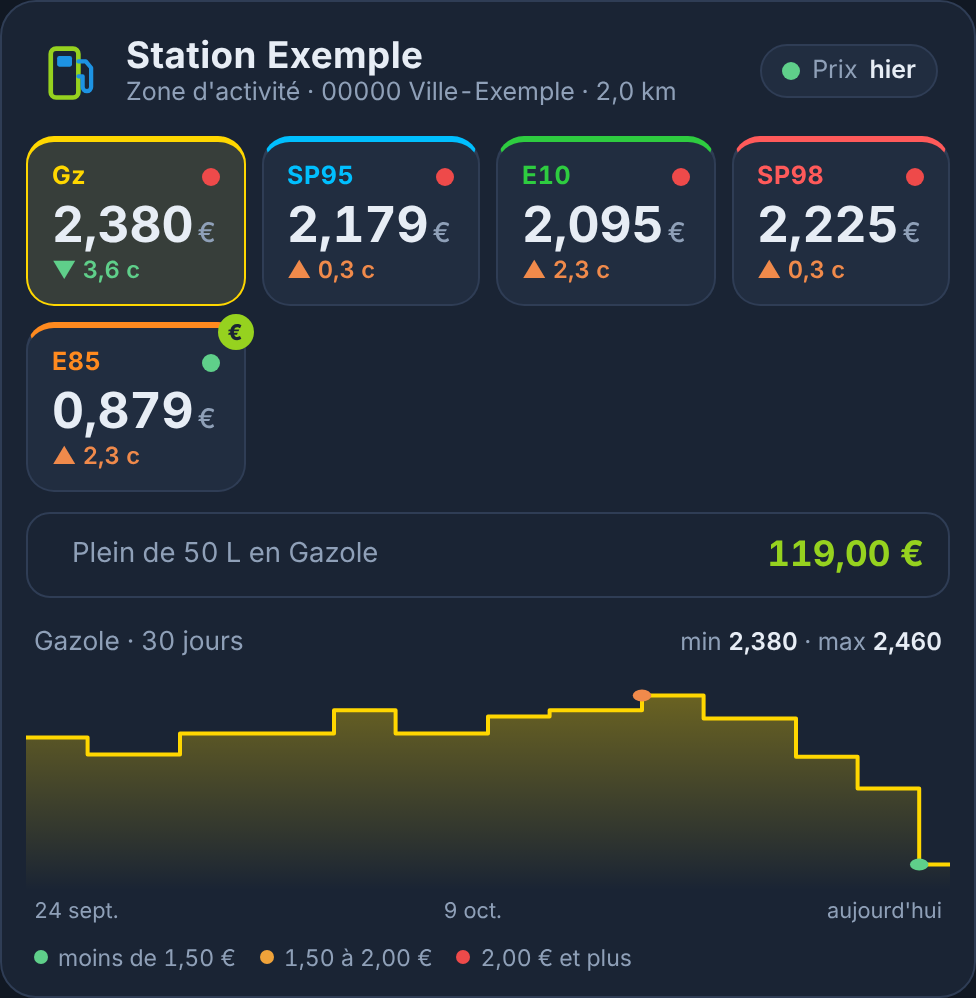
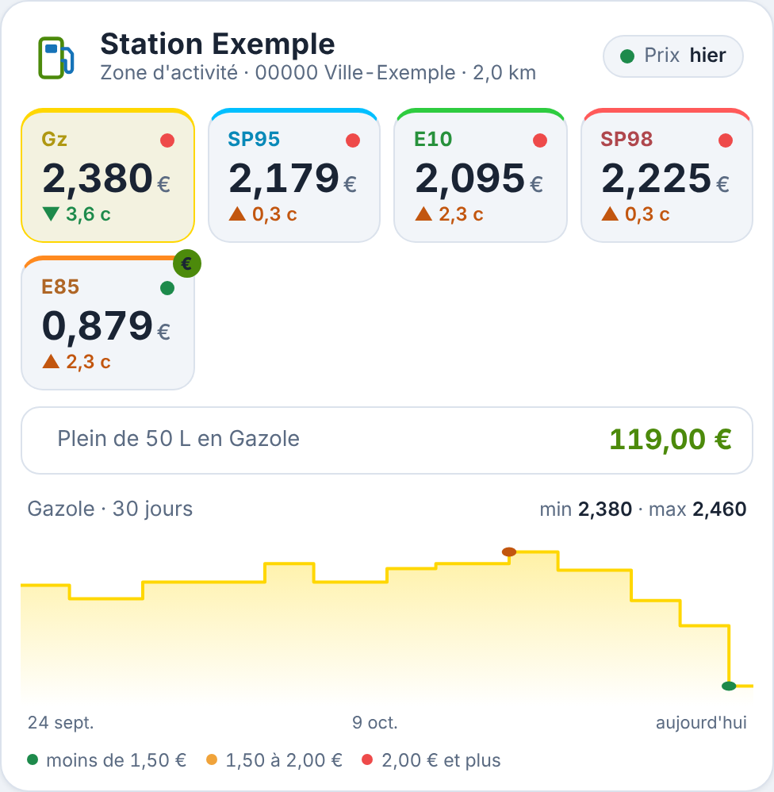
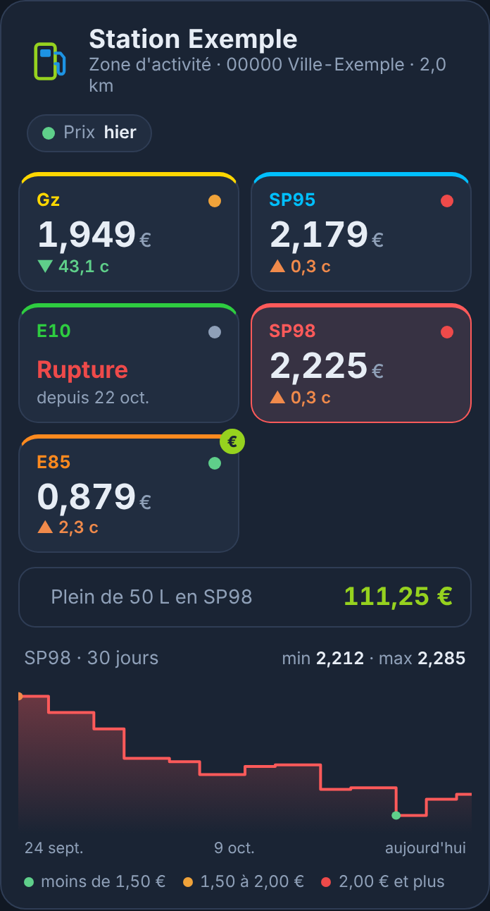

# Carte Prix Carburant

Carte Lovelace pour Home Assistant qui affiche les **prix d'une station-service** : un prix par carburant avec une couleur selon vos seuils, l'évolution depuis le dernier changement, l'historique des 30 derniers jours, le coût d'un plein et les ruptures de stock.

Elle est conçue pour l'intégration **[Prix Carburant](https://github.com/Aohzan/hass-prixcarburant)** (données officielles prix-carburants.gouv.fr) et trouve votre station toute seule. Pour une autre source, les capteurs peuvent être choisis à la main.

Elle a le même style que la [Carte Enedis Linky New](https://github.com/Marlboro62/content-card-linky-new), mais elle est **indépendante** : type `custom:prix-carburant-card`, ressource à part.

🎮 **[Essayer la démo en ligne](https://marlboro62.github.io/prix-carburant-card/docs/demo.html)** : la vraie carte avec des données simulées, sans installer Home Assistant.

| Bleu nuit | Clair | Rupture, baisse de prix (téléphone) |
| --- | --- | --- |
|  |  |  |

*Aperçus avec une station fictive, des prix et un historique simulés.*

## Ce que la carte affiche

- **En-tête** : logo de l'enseigne, nom, adresse et distance de la station, et une **pastille** qui indique quand la station a mis ses prix à jour (orange au-delà de 3 jours).
- **Une tuile par carburant** (Gazole, SP95, SP95-E10, SP98, E85, GPLc) :
  - le prix au millième, avec la couleur habituelle du carburant ;
  - une **pastille de couleur** selon vos seuils : 🟢 sous 1,50 €, 🟠 de 1,50 à 2 €, 🔴 à partir de 2 € (réglables) ;
  - l'**écart avec le prix précédent**, en centimes (▲ hausse, ▼ baisse) ;
  - **« Rupture depuis… »** quand la station est en rupture de stock ;
  - un badge **€** sur le carburant le moins cher de la station.
- **Coût d'un plein**, si vous indiquez la capacité de votre réservoir.
- **Évolution du prix** sur 30 jours du carburant choisi (touchez une tuile), avec le minimum, le maximum et les lignes de vos seuils.

Un appui sur l'en-tête, le plein ou la courbe ouvre la fiche du capteur.

## Installation

### Avec HACS (recommandé)

1. Dans HACS, menu **⋮** → **Dépôts personnalisés**.
2. Ajoutez `https://github.com/Marlboro62/prix-carburant-card` avec le type **Tableau de bord** (Dashboard).
3. Cherchez **Carte Prix Carburant**, installez-la, puis rechargez la page (Ctrl+F5).

### Manuellement

1. Téléchargez [`prix-carburant-card.js`](https://raw.githubusercontent.com/Marlboro62/prix-carburant-card/main/prix-carburant-card.js) (clic droit → Enregistrer sous) et copiez-le dans `/config/www/`.
2. **Paramètres → Tableaux de bord → ⋮ → Ressources → Ajouter une ressource** :
   - URL : `/local/prix-carburant-card.js`
   - Type : **Module JavaScript**
3. Rechargez la page (Ctrl+F5).

## Configuration

Avec une seule station dans l'intégration Prix Carburant, rien à configurer :

```yaml
type: custom:prix-carburant-card
```

La carte prend la première station de l'intégration. S'il y en a plusieurs, choisissez-la dans l'**éditeur visuel** (champ `station`) : une carte par station.

| Option | Rôle | Défaut |
| --- | --- | --- |
| `station` | Identifiant de la station (attribut `station_id` des capteurs) | la première trouvée |
| `title` | Titre de la carte | nom de la station |
| `fuels` | Carburants affichés, dans l'ordre : `gazole`, `sp95`, `e10`, `sp98`, `e85`, `gplc` | tous |
| `threshold_orange` | Prix (€/L) à partir duquel la pastille passe à l'orange | `1.5` |
| `threshold_red` | Prix (€/L) à partir duquel la pastille passe au rouge | `2.0` |
| `tank` | Capacité du réservoir en litres, pour le coût d'un plein (`0` = masqué) | `0` |
| `days` | Durée de l'historique (2 à 90 jours) | `30` |
| `show_chart` | Afficher l'évolution du prix | `true` |
| `theme` | `v2` (bleu nuit MyElectricalData), `auto` (clair ou sombre selon HA), `ha` (thème Home Assistant) | `v2` |
| `entities` | Capteurs choisis à la main (voir ci-dessous) | — |

Un exemple complet est dans [`exemples/carte-carburant.yaml`](exemples/carte-carburant.yaml).

### Capteurs choisis à la main

Pour une autre intégration, donnez la liste des capteurs de prix (en €/L). Le carburant est lu dans l'attribut `fuel_type`, ou à défaut à la fin du nom d'entité (`…_gazole`, `…_sp98`…) :

```yaml
type: custom:prix-carburant-card
title: Ma station
entities:
  - sensor.ma_station_gazole
  - sensor.ma_station_sp98
```

> L'écart avec le prix précédent et la courbe viennent de l'**historique de Home Assistant** (recorder). Après l'installation de l'intégration, ils apparaissent au premier changement de prix.

## Support

Questions et problèmes : uniquement via les [issues GitHub](https://github.com/Marlboro62/prix-carburant-card/issues).

## Voir aussi

- [Carte Enedis Linky New](https://github.com/Marlboro62/content-card-linky-new) · [Carte Linky Appareils](https://github.com/Marlboro62/linky-appareils-card) · [Carte Onduleur UPS](https://github.com/Marlboro62/onduleur-ups-card)

Si la carte vous est utile : [Buy Me a Coffee](https://buymeacoffee.com/marlboro62) · [Ko-fi](https://ko-fi.com/nothing_one)

## Licence

MIT
